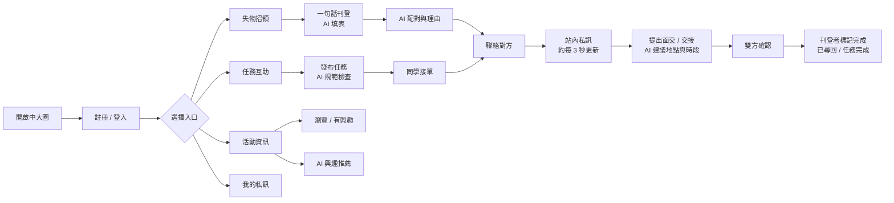
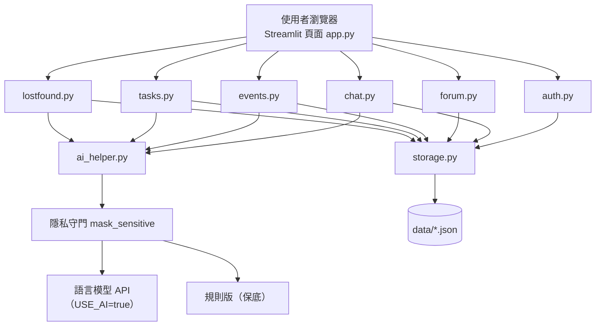

<div align="center">

# 🎓 開發規格

**找得回物品，幫得上同學，逛得到活動**
三個校園生活入口，一條安全的站內私訊通道

Microsoft × NCU AI Innovation Demo Day｜AI 創新應用主題挑戰賽
主題：AI for Better Campus & Life｜用 AI，讓學習、校園與生活更好

`Python 3` · `Streamlit` · `JSON` · `準即時私訊` · `規則＋AI 雙軌`

</div>

---


<details>
<summary><b>📑 目錄</b></summary>

1. 專案目標與功能參考 · 2. 問題與需求 · 3. 使用者與情境 · 4. MVP 功能表 · 5. AI 能力層 · 6. 使用流程與架構
7. 技術與限制 · 8. 資料格式 · 9. 檔案結構 · 10. 函式清單與分工 · 11. 測試與驗收
12. 競賽對照 · 13. 原創性、智慧財產與負責任使用 AI · 14. 風險與備案 · 15. 時程 · 16. 評審預想問答
附錄 A：給 Copilot 的提示詞 · 附錄 B：AI 協作紀錄範本 · 附錄 C：產品內 AI 提示詞與輸出格式

</details>

---

## 1. 專案目標與功能參考

**一句話目標**

> 讓中大同學在同一個網頁入口，**找回遺失物品、互相幫忙、發現校園活動**，並以**站內私訊**安全地聯絡與約定交接。

**三個入口**

| 入口 | 一句話 | 核心行為 |
|---|---|---|
| 🔎 失物招領 | 找得回 | 刊登遺失／拾獲 → AI 配對 → 私訊 → 面交 |
| 🤝 任務互助 | 幫得上 | 發布代拿、代跑、揪人、日常求助 → 接單 → 私訊 → 完成 |
| 🎪 活動資訊 | 逛得到 | 瀏覽社團與校園活動 → 標記有興趣 → AI 依興趣推薦 |

**設計目標**（是我們要做到的設計，不是已經證明的成效）

1. 發布與搜尋都不需要複雜操作，第一次使用的同學不看說明也能完成。
2. 以**結構化欄位**讓搜尋、配對與推薦可行；**聯絡一律走站內私訊，不公開個人聯絡方式**。
3. AI 負責「降低輸入負擔、提高找到的機會、守住隱私與安全」，**不取代人的判斷**，每項 AI 功能都有不靠 AI 也能運作的保底版本。


---

## 2. 問題與需求

### 2.1 問題陳述（初稿，待訪談修正）

> 中央大學的學生在**遺失物品**、**臨時需要同學幫忙**、**想找校園活動**時，資訊與管道分散在多個社群群組與公布欄之間，難以搜尋；


## 3. 使用者與情境

| 角色 | 使用者故事 | 對應功能 |
|---|---|---|
| 遺失者（小宇） | 身為遺失物品的人，我想**用一句話刊登**，看到可能的拾獲配對，再**私訊**對方約面交 | M1、CH、AI-1、AI-2 |
| 拾獲者（小晴） | 身為撿到東西的人，我想**不公開聯絡方式**，並確認來認領的人真的是失主 | M1、CH、AI-3、AI-5 |
| 任務發布者（小安） | 身為下雨天不想出門的同學，我想發布「代拿」任務並說明酬勞，由有空的同學接單 | M2、CH、AI-6 |
| 任務接單者（小凱） | 身為有空的同學，我想瀏覽任務並接下順路的，再私訊確認細節 | M2、CH |
| 新生／社團幹部 | 身為新生，我想**用興趣找到活動**；身為社團幹部，我想**一句話發布**活動 | M3、AI-1、AI-7 |
---

## 4. MVP 功能表

> 規則：核心模組要能在 **3 分鐘內 Demo 完**。**AI 不是獨立模組，而是貫穿各模組的能力層**（見第 5 章）。因為功能較多，以**優先級**控管：P0 必交、P1 有時間再做，第 14 章寫了砍範圍順序。

### 4.1 共用平台

| 編號 | 功能 | 說明 | 優先級 |
|---|---|---|---|
| **PL** | 登入 | 暱稱＋密碼（示範等級，非校園帳號；V2 評估串接校方登入） | P0 |
| **CH** | 站內私訊與約定 | 一對一私訊（約每 3 秒更新）、提出面交／交接地點與時間、雙方確認；供失物招領與任務互助共用 | P0 |

### 4.2 核心模組

| 編號 | 功能 | 使用者做什麼 | 程式要做什麼 | 優先級 |
|---|---|---|---|---|
| **M1** | 失物招領 | 刊登「遺失／拾獲」（可用一句話）、依類別／地點／關鍵字搜尋、看配對、聯絡對方、標記「已尋回」 | 存讀 `lostfound.json`；篩選；配對計分；僅刊登者可改狀態 | P0 |
| **M2** | 任務互助 | 發布任務（代拿代購／代跑腿／揪人／日常求助）、依類型與關鍵字瀏覽、接單、私訊、完成或取消 | 存讀 `tasks.json`；名額管理；僅發布者可完成／取消；任務規範檢查 | P0 |
| **M3** | 活動資訊 | 發布活動、依分類與關鍵字瀏覽、標記「有興趣」、點外部連結、輸入興趣取得推薦 | 存讀 `events.json`；依時間排序；興趣名單；推薦 | P0（精簡版） |
| **M4** | 討論區 | 發文、分類瀏覽、搜尋、留言 | 存讀 `posts.json`；篩選；排序 | P1 |

**各模組最小可交付**：M1＝刊登＋搜尋＋配對＋已尋回；M2＝發布＋瀏覽＋接單＋完成；M3＝發布＋瀏覽＋有興趣；CH＝送訊息＋面交約定。


---

## 5. AI 能力層

評審一定會問「這只是篩選與聊天，AI 在哪？」答案是：**AI 解決的是「人在這個流程裡最麻煩、最不安心的地方」**。

### 5.1 兩個層次

| 層次 | AI 做什麼 | 人做什麼 | 留下的證據 |
|---|---|---|---|
| **開發過程** | 聊天 AI 協助釐清問題、設計 MVP、寫 spec.md；GitHub Copilot 搭骨架、填函式、解釋與除錯 | 刪減範圍、審查每一行、決定取捨 | `docs/ai-log.md` |
| **作品功能** | 七項 AI 功能（見 5.2），貫穿失物招領、任務互助、活動資訊與私訊 | 所有 AI 輸出都是「建議」，由使用者確認後才送出或儲存 | 畫面標示「AI 建議」或「規則建議」 |

### 5.2 作品中的七項 AI 功能

| 編號 | 功能 | 位置 | AI 做什麼 | 規則版保底（無網路／無金鑰） | 優先級 |
|---|---|---|---|---|---|
| **AI-1** | 一句話發布 | M1、M2、M3 | 一句話自動填入表單。例：「昨天下午在圖書館掉了黑色保溫水壺」「明天中午幫我帶一杯飲料到圖書館，請你喝一杯」「週五晚上有攝影社新生體驗」；缺漏欄位提醒補填 | 關鍵字表＋日期詞（今天／昨天／明天…）＋地點清單 | **P0**（失物）／P1（任務、活動） |
| **AI-2** | 智慧配對與理由 | M1 → CH | 規則計分找出候選，AI 為每筆配對產生一句白話理由，可一鍵開啟私訊 | 計分規則＋模板理由 | **P0** |
| **AI-3** | 隱私守門員 | 全部 | 偵測學號、手機、Email、身分證字號：公開內容**自動遮蔽**；私訊中**提醒**後由使用者決定；**任何文字送進 AI 前先遮蔽** | 規則偵測（此項以規則為主，AI 語意補強列 V2） | **P0** |
| **AI-4** | 面交／交接安全助手 | CH | 依物品或任務類型建議**公共地點**與**時段**、產生安全小提醒、提供 3 則快速回覆草稿 | 固定的安全地點清單＋通用提醒＋預設回覆 | P1 |
| **AI-5** | 認領驗證問題 | M1 → CH | 拾獲者刊登時，AI 建議「只有失主才答得出」的問題；認領者回答後由拾獲者**人工判斷**是否通過 | 依類別的問題模板 | P1 |
| **AI-6** | 任務規範檢查 | M2 | 發布前檢查是否涉及**學術不誠信**（代考、代寫、代簽到）、**違禁品**（菸酒、藥品）、**索取帳號密碼或個資**，並提醒風險（先匯款、深夜、校外見面）；結果分「通過／提醒／禁止」 | 關鍵字規則（`禁止` 類由規則直接擋下，不依賴 AI） | **P0**（規則）／P1（AI 語意補強） |
| **AI-7** | 活動智慧推薦 | M3 | 使用者輸入興趣（例：「喜歡攝影，想認識新朋友」），AI **只從現有活動清單中**挑最多 3 個並說明理由 | 興趣關鍵字與活動標籤重疊計分 | P1 |

### 5.3 AI 設計原則

1. **人在迴圈**：AI 只提供建議，不自動發布、不自動送出私訊、不自動判定認領、不自動核准任務。
2. **雙軌保底**：`USE_AI=false` 為預設；AI 失敗、逾時、輸出格式錯誤時，自動退回規則版，畫面不報錯。
3. **標示來源**：每個 AI 結果回傳 `source`（`"AI"` 或 `"規則"`），畫面顯示標籤。
4. **最小資料原則**：送給語言模型的文字一律先經 `mask_sensitive`；私訊內容只送最近 6 則。
5. **不編造**：提示詞要求只使用提供的資訊；面交地點只能從白名單挑選；活動推薦只能從現有清單挑選。
6. **輸出驗證**：AI 回傳的 JSON 要檢查欄位、列舉值與 id 是否真實存在，不合法即視為失敗並退回規則版。
7. **安全規則不外包給 AI**：任務的 `禁止` 判定以規則為準，AI 只能「加嚴」（多提醒），不能「放行」規則已擋下的內容。

```
USE_AI = False（預設）→ 規則版   ← 沒有網路與金鑰也能完整 Demo
USE_AI = True          → AI 版    ← 呼叫語言模型；失敗時自動退回規則版
```

> 語言模型來源以團隊實際可取得的帳號為準（優先考慮 Microsoft 生態系，如 Azure OpenAI 或 GitHub Models，**可用性待確認**）。無論選哪個，都經由 `ai_helper.call_llm` 統一呼叫。

---

## 6. 使用流程與架構

### 6.1 使用流程



### 6.2 系統架構



---

## 7. 技術與限制

- **語言與介面**：Python 3 ＋ Streamlit（網頁）
- **資料儲存**：JSON 檔（`data/`），**不使用資料庫**
- **語法限制**：只用 `for`、`if`、`list`、`dict`、函式、讀寫檔案。例外：標準函式庫 `json`、`os`、`datetime`、`hashlib`
- **讀寫檔一律指定** `encoding="utf-8"`（Windows 預設 cp950 會報錯）
- **程式加上中文註解**；每個函式開頭用一行說明用途
- **不自行訓練模型**
- **例外套件（須先 `/explain` 看懂才能保留）**：`ai_helper.py` 的 API 呼叫段可用 `requests`、`python-dotenv`；`detect_sensitive` 可用標準函式庫 `re`
- **金鑰**：放在 `.env`，不寫進程式，不貼給他人，`.env` 不上傳 GitHub
- **酬勞與金流**：任務的 `reward` 只是雙方自行約定的文字說明，**平台不經手任何金錢**
- **完成期限**：2026-12-04 前完成可 Demo 的版本

### 7.1 「準即時」私訊的作法與誠實聲明

Streamlit 不是為即時通訊設計的。MVP 採用**輪詢**：聊天視窗以 `st.fragment(run_every=3)` 每 3 秒重新讀取 `chats.json` 並更新畫面。

```python
@st.fragment(run_every=3)          # 每 3 秒自動重新執行這一小塊
def chat_box(thread_id, me):
    threads = load_data(CHAT_PATH)  # 重新讀檔，取得對方新訊息
    ...                             # 用 st.chat_message 顯示訊息
```

- 簡報與 README 的用語是「**準即時（約 3 秒更新）**」，不寫成「WebSocket 即時通訊」。
- `st.fragment` 的 `run_every` 需要較新版本的 Streamlit（約 1.37 以上，**以實際安裝版本與實測為準**）；`requirements.txt` 需鎖定測試通過的版本。
- 兩人同時送訊息可能互相覆蓋：`send_message` 的呼叫端必須在**寫入前立刻重新讀檔再附加**，縮小衝突時間窗；V2-6 再改為真正的即時資料庫。

### 7.2 身分與權限（示範等級）

| 規則 | 說明 |
|---|---|
| 登入 | 暱稱（2–12 字、不重複）＋密碼（至少 4 碼），密碼以 `hashlib.sha256` 雜湊後儲存，不存明碼 |
| 私訊權限 | 只有 `owner` 與 `peer` 兩人能讀寫該討論串（`is_participant`） |
| 失物狀態 | 只有刊登者能標記「已尋回」，也只有刊登者能判定認領驗證 |
| 任務權限 | 只有發布者能「完成」或「取消」；不能接自己的任務；額滿後不可再接；同一人不可重複接單 |
| 自己的刊登 | 不能對自己的刊登或任務開啟私訊 |
| 限制 | 這是展示可行性的示範機制，**不是正式安全方案**；JSON 為本機檔案，管理者可直接讀取，V2 改用校方登入與資料庫 |

### 7.3 設定檔 `.env.example`

| 變數 | 預設 | 說明 |
|---|---|---|
| `USE_AI` | `false` | `true` 時嘗試呼叫語言模型，失敗自動退回規則版 |
| `AI_API_KEY` | （空） | 金鑰，只放在本機 `.env` |
| `AI_TIMEOUT` | `5` | 單次呼叫逾時秒數 |

**安裝與執行**

```bash
pip install -r requirements.txt     # streamlit（鎖版本）、python-dotenv、requests
streamlit run app.py                # 若找不到指令：python -m streamlit run app.py
```

---

## 8. 資料格式

> 所有示範資料皆為**虛構**，畫面固定標示「示範資料」。

### 8.1 `data/users.json`（帳號）

```json
[
  {"nickname": "小宇", "password_hash": "（sha256 十六進位字串）", "created_at": "2026-11-18 09:00"}
]
```

### 8.2 `data/lostfound.json`（失物招領）

```json
[
  {
    "id": 2,
    "kind": "拾獲",
    "name": "黑色保溫水壺",
    "category": "雨傘水壺",
    "location": "圖書館",
    "date": "2026-11-18",
    "description": "黑色、約 500ml，瓶身有貼紙。",
    "keywords": ["黑色", "水壺", "貼紙"],
    "owner": "小晴",
    "verify_questions": ["瓶身貼紙是什麼圖案？", "瓶蓋或瓶身有哪些刮痕或凹痕？"],
    "verify_answers": ["（拾獲者私下填寫，不顯示給他人）", "（同左）"],
    "status": "尋找中",
    "created_at": "2026-11-18 20:10"
  }
]
```

| 欄位 | 型別 | 說明 |
|---|---|---|
| `kind` | str | `遺失` 或 `拾獲` |
| `category` | str | 證件卡片／3C電子／雨傘水壺／衣物配件／鑰匙／書籍文具／其他 |
| `date` | str | `YYYY-MM-DD` |
| `owner` | str | 刊登者暱稱；**沒有公開的聯絡方式欄位** |
| `verify_questions` / `verify_answers` | list[str] | 僅 `拾獲` 使用；答案只給刊登者看（介面層控管） |
| `status` | str | `尋找中` 或 `已尋回` |

### 8.3 `data/tasks.json`（任務互助）

```json
[
  {
    "id": 1,
    "type": "代拿代購",
    "title": "幫忙帶一杯飲料到圖書館",
    "description": "下午有課走不開，想請順路的同學幫忙。",
    "location": "圖書館",
    "deadline": "2026-11-25 15:00",
    "reward": "請喝一杯飲料（雙方自行約定，平台不經手金流）",
    "slots": 1,
    "helpers": [],
    "keywords": ["代拿", "飲料"],
    "owner": "小安",
    "status": "招募中",
    "created_at": "2026-11-24 10:00"
  }
]
```

| 欄位 | 型別 | 說明 |
|---|---|---|
| `type` | str | 代拿代購／代跑腿／揪人／日常求助 |
| `deadline` | str | `YYYY-MM-DD HH:MM` |
| `slots` / `helpers` | int / list[str] | 需要人數與已接單者；`揪人` 可大於 1 |
| `status` | str | 招募中／已額滿／已完成／已取消 |

### 8.4 `data/events.json`（活動資訊）

```json
[
  {
    "id": 1,
    "title": "（虛構）攝影社新生體驗",
    "org": "（虛構）示範攝影社",
    "category": "社團招生",
    "place": "示範地點",
    "start": "2026-12-05 18:30",
    "end": "2026-12-05 20:00",
    "description": "認識器材與拍攝基礎，歡迎新手。",
    "tags": ["攝影", "新生", "社團"],
    "link": "",
    "owner": "小晴",
    "interested": ["小宇"],
    "created_at": "2026-11-26 09:00"
  }
]
```

| 欄位 | 型別 | 說明 |
|---|---|---|
| `category` | str | 學術講座／藝文表演／運動競賽／志工服務／社團招生／其他 |
| `link` | str | **發布者自行填寫**的報名或資訊連結（選填）；系統只顯示連結，不抓取、不轉載連結內容或海報 |
| `interested` | list[str] | 標記「有興趣」的暱稱 |

### 8.5 `data/chats.json`（私訊討論串，失物與任務共用）

```json
[
  {
    "id": 1,
    "target_type": "item",
    "target_id": 2,
    "target_title": "黑色保溫水壺",
    "owner": "小晴",
    "peer": "小宇",
    "claim_answers": ["貓咪圖案", "瓶蓋有一道刮痕"],
    "verified": "未驗證",
    "meetup": {
      "place": "圖書館一樓服務台前",
      "time": "2026-11-21 12:30",
      "proposed_by": "小宇",
      "confirmed_by": ["小宇", "小晴"],
      "status": "已確認"
    },
    "messages": [
      {"id": 1, "sender": "小宇", "text": "你好，這個水壺可能是我的。", "kind": "user", "created_at": "2026-11-19 08:01"},
      {"id": 2, "sender": "系統", "text": "小宇提出面交：圖書館一樓服務台前，11/21 12:30", "kind": "system", "created_at": "2026-11-19 08:10"}
    ],
    "created_at": "2026-11-19 08:00",
    "updated_at": "2026-11-19 08:10"
  }
]
```

| 欄位 | 型別 | 說明 |
|---|---|---|
| `target_type` | str | `item`（失物）或 `task`（任務） |
| `owner` / `peer` | str | 刊登者或發布者／發起聯絡或接單者，即討論串唯一的兩位參與者 |
| `claim_answers` | list[str] | 認領者回答驗證問題的內容；僅 `拾獲` 的 item 使用，其餘為 `[]` |
| `verified` | str | `未驗證`／`通過`／`未通過`；`task` 與 `遺失` 類 item 固定為 `不適用` |
| `meetup` | dict 或 null | 尚未提出時為 `null`；`status` 為 `待確認` 或 `已確認` |
| `messages[].kind` | str | `user`（使用者）、`system`（系統）、`ai`（AI 建議，僅顯示不自動送出） |
| `messages[].id` | int | 討論串內遞增，供 `get_new_messages` 取得新訊息 |

> `揪人` 任務有多位接單者時，**每位接單者各一個討論串**（同一任務、不同 `peer`）。

### 8.6 `data/posts.json`（討論區，P1）

```json
[
  {
    "id": 1,
    "title": "大一選課問題：通識怎麼排比較順？",
    "content": "想請教學長姐通識選課的順序與注意事項。",
    "category": "課程與學習",
    "nickname": "小安",
    "tags": ["選課", "通識"],
    "created_at": "2026-11-20 14:30",
    "comments": [
      {"nickname": "學長", "content": "建議先看選課說明會。", "created_at": "2026-11-20 15:02"}
    ]
  }
]
```

`category`：課程與學習／校園生活／社團活動／問題求助／閒聊。

> 🔒 **隱私規則**　公開內容（刊登描述、任務、活動、貼文、留言）送出前由 `mask_sensitive` 遮蔽學號等資料；表單固定提醒「請勿提供學號、身分證字號」。

---

## 9. 檔案結構

```
ncu-loop/
├── app.py              # 櫃台：Streamlit 頁面與導覽
├── storage.py          # 倉庫：讀寫 JSON、產生編號
├── auth.py             # 帳號：註冊、登入、密碼雜湊
├── lostfound.py        # 失物招領邏輯（M1）
├── tasks.py            # 任務互助邏輯（M2）
├── events.py           # 活動資訊邏輯（M3）
├── forum.py            # 討論區邏輯（M4，P1）
├── chat.py             # 私訊與面交邏輯（CH）
├── ai_helper.py        # AI／規則雙軌輔助與隱私守門（AI-1～AI-7）
├── data/
│   ├── users.json
│   ├── lostfound.json
│   ├── tasks.json
│   ├── events.json
│   ├── posts.json
│   └── chats.json
├── docs/
│   └── ai-log.md       # AI 協作紀錄
├── spec.md             # 本文件
├── README.md           # 含第三方套件與素材授權清單
├── requirements.txt
└── .env.example        # 金鑰範本（不含真實金鑰）
```

---

## 10. 函式清單與分工

> ⚠️ **函式名稱、參數、回傳值不得私自更動**，否則整合會出錯。要改，先改本文件並通知全組。
>
> **雙軌 AI 函式**（`parse_form_text`、`suggest_tags`、`make_match_reason`、`make_verify_questions`、`check_task_rules`、`recommend_events`、`suggest_meetup`、`quick_replies`）統一回傳 `{"data": 結果, "source": "AI" 或 "規則"}`，以便畫面標示來源；下表「輸出」欄寫的是 `data` 的內容。`call_llm`、`detect_sensitive`、`mask_sensitive` 與一般邏輯函式不套用此格式。

### 10.1 基礎與帳號

| 檔案 | 函式 | 輸入 | 輸出 | 負責 |
|---|---|---|---|---|
| storage.py | `load_data(path)` | 檔案路徑 | list（檔案不存在回傳 `[]`） | A |
| storage.py | `save_data(path, data)` | 路徑、list | 無 | A |
| storage.py | `get_next_id(items)` | list | int（最大 id + 1，空則 1） | A |
| storage.py | `now_text()` | 無 | str，如 `"2026-11-20 14:30"` | A |
| auth.py | `hash_password(password)` | str | str（sha256 十六進位） | E |
| auth.py | `register_user(users, nickname, password)` | list、str、str | dict：`{"ok": bool, "message": str, "user": dict 或 None}`；暱稱 2–12 字且不重複、密碼 ≥ 4 碼 | E |
| auth.py | `login_user(users, nickname, password)` | list、str、str | bool | E |

### 10.2 失物招領（M1）

| 檔案 | 函式 | 輸入 | 輸出 | 負責 |
|---|---|---|---|---|
| lostfound.py | `create_item(kind, name, category, location, date, description, keywords, owner, verify_questions, verify_answers)` | 8 個 str／list；`verify_*` 遺失類傳 `[]` | dict（新紀錄，尚未存檔） | D |
| lostfound.py | `search_items(items, kind, category, keyword, status)` | list＋4 個篩選值 | list | D |
| lostfound.py | `mark_resolved(item, nickname)` | dict、str | bool（`nickname` 等於 `owner` 才改為 `已尋回` 並回傳 True） | E |
| lostfound.py | `find_matches(item, items)` | dict、list | list[dict]，每筆 `{"item": dict, "score": int}`，由高到低最多 3 筆 | E |

### 10.3 任務互助（M2）

| 檔案 | 函式 | 輸入 | 輸出 | 負責 |
|---|---|---|---|---|
| tasks.py | `create_task(task_type, title, description, location, deadline, reward, slots, keywords, owner)` | str×6、int、list、str | dict（新任務，狀態 `招募中`，尚未存檔） | B |
| tasks.py | `list_tasks(tasks, task_type, keyword, status)` | list＋3 個篩選值（`"全部"` 與空字串代表不篩選） | list（依 `deadline` 由近到遠） | B |
| tasks.py | `accept_task(task, nickname)` | dict、str | dict：`{"ok": bool, "message": str, "task": dict}`；擋下發布者本人、重複接單、非 `招募中`；人數達 `slots` 時改為 `已額滿` | B |
| tasks.py | `complete_task(task, nickname)` | dict、str | bool（僅發布者、且狀態為 `招募中` 或 `已額滿`，改為 `已完成`） | B |
| tasks.py | `cancel_task(task, nickname)` | dict、str | bool（僅發布者，改為 `已取消`） | B |

### 10.4 活動資訊（M3）

| 檔案 | 函式 | 輸入 | 輸出 | 負責 |
|---|---|---|---|---|
| events.py | `create_event(title, org, category, place, start, end, description, tags, link, owner)` | str×8、list、str | dict（新活動，`interested` 為 `[]`，尚未存檔） | C |
| events.py | `list_events(events, category, keyword, only_upcoming)` | list、str、str、bool | list（依 `start` 由近到遠；`only_upcoming` 為真時排除已結束者） | C |
| events.py | `toggle_interest(event, nickname)` | dict、str | dict（有則移除、無則加入，更新後的活動） | C |

### 10.5 私訊與面交（CH，失物與任務共用）

| 檔案 | 函式 | 輸入 | 輸出 | 負責 |
|---|---|---|---|---|
| chat.py | `open_thread(threads, target_type, target, peer, claim_answers)` | list、`"item"` 或 `"task"`、dict、str、list | dict（同一目標同一 `peer` 已有討論串就回傳舊的，否則新建；`peer` 等於 `owner` 回傳 `None`） | D |
| chat.py | `get_threads_for_user(threads, nickname)` | list、str | list（該使用者參與的討論串，依 `updated_at` 新到舊） | D |
| chat.py | `is_participant(thread, nickname)` | dict、str | bool | D |
| chat.py | `send_message(thread, sender, text, kind)` | dict、str、str、str | dict（附加訊息並更新 `updated_at`；非參與者、空白訊息則原樣回傳） | E |
| chat.py | `get_new_messages(thread, last_id)` | dict、int | list（`id` 大於 `last_id` 的訊息） | E |
| chat.py | `propose_meetup(thread, sender, place, time_text)` | dict、str、str、str | dict（設定 `meetup`，狀態 `待確認`，提出者自動算已確認，並加系統訊息） | E |
| chat.py | `confirm_meetup(thread, nickname)` | dict、str | dict（對方確認後狀態改 `已確認`，並加系統訊息；提出者自己不能重複確認） | E |
| chat.py | `verify_claim(thread, nickname, passed)` | dict、str、bool | dict（僅 `owner`、且 `target_type` 為 `item` 才可設定 `verified` 為 `通過`／`未通過`，並加系統訊息） | E |

### 10.6 AI 能力與隱私守門（AI-1～AI-7）

| 檔案 | 函式 | 輸入 | 輸出（`data` 的內容） | 負責 |
|---|---|---|---|---|
| ai_helper.py | `call_llm(system_prompt, user_text)` | str、str | str 或 `None`（`USE_AI` 關閉、無金鑰、逾時、錯誤一律回傳 `None`）；**呼叫前必須已遮蔽個資** | A |
| ai_helper.py | `detect_sensitive(text)` | str | list[dict]，每筆 `{"type": 類型, "value": 內容}`；類型：學號、手機、Email、身分證（AI-3） | C |
| ai_helper.py | `mask_sensitive(text)` | str | str（敏感內容以 `＊` 遮蔽）（AI-3） | C |
| ai_helper.py | `parse_form_text(text, form_type)` | 一句話、`"item"`／`"task"`／`"event"` | dict：欄位依表單類型（見 10.9），另含 `missing`（AI-1） | D |
| ai_helper.py | `suggest_tags(text, kind)` | str、`"item"`／`"task"`／`"event"`／`"post"` | list[str]，最多 5 個（AI-1） | D |
| ai_helper.py | `make_match_reason(item_a, item_b)` | dict、dict | str，一句白話理由（AI-2） | D |
| ai_helper.py | `make_verify_questions(item)` | dict（只讀公開欄位） | list[str]，2 個驗證問題（AI-5） | D |
| ai_helper.py | `check_task_rules(title, description)` | str、str | dict：`{"level": "通過"／"提醒"／"禁止", "reasons": list[str]}`（AI-6） | B |
| ai_helper.py | `recommend_events(events, interest_text)` | list、str | list[dict]，每筆 `{"event": dict, "reason": str}`，最多 3 筆且皆須來自 `events`（AI-7） | C |
| ai_helper.py | `suggest_meetup(target_type, target, thread)` | str、dict、dict | dict：`{"spots": list, "slots": list, "tips": str}`；`spots` 只能出自白名單 `SAFE_SPOTS`（AI-4） | A |
| ai_helper.py | `quick_replies(thread, me)` | dict、str | list[str]，3 則 ≤ 20 字的回覆草稿（AI-4） | A |

### 10.7 討論區（M4，P1）

| 檔案 | 函式 | 輸入 | 輸出 | 負責 |
|---|---|---|---|---|
| forum.py | `create_post(title, content, category, nickname, tags)` | str×4、list | dict（新貼文，尚未存檔） | B |
| forum.py | `list_posts(posts, category, keyword)` | list、str、str | list（比對標題、內容、標籤；`"全部"` 與空字串代表不篩選） | B |
| forum.py | `add_comment(post, nickname, content)` | dict、str、str | dict（更新後的貼文） | C |
| forum.py | `sort_posts(posts, mode)` | list、`"最新"` 或 `"最多留言"` | list | C |

### 10.8 畫面

| 檔案 | 函式 | 說明 | 負責 |
|---|---|---|---|
| app.py | `render_auth_sidebar()` | 側邊欄登入／註冊／登出，以 `st.session_state` 保存登入者 | A |
| app.py | `render_lostfound_page()` | 失物招領頁（含 AI-1、AI-2、AI-5） | D |
| app.py | `render_task_page()` | 任務互助頁（含 AI-1、AI-6） | B |
| app.py | `render_event_page()` | 活動資訊頁（含 AI-1、AI-7） | C |
| app.py | `render_forum_page()` | 討論區頁（P1） | C |
| app.py | `render_chat_page()` | 我的私訊（`chat_box` 準即時、面交卡片、AI-4、AI-3 提醒） | E、A |
| app.py | `main()` | 導覽、未登入導向、整合 | A |


---
